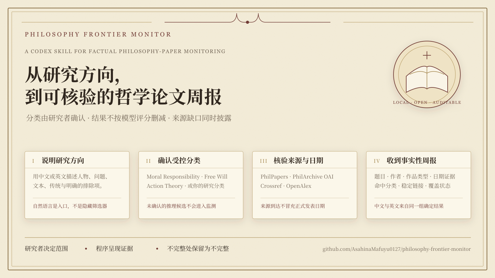
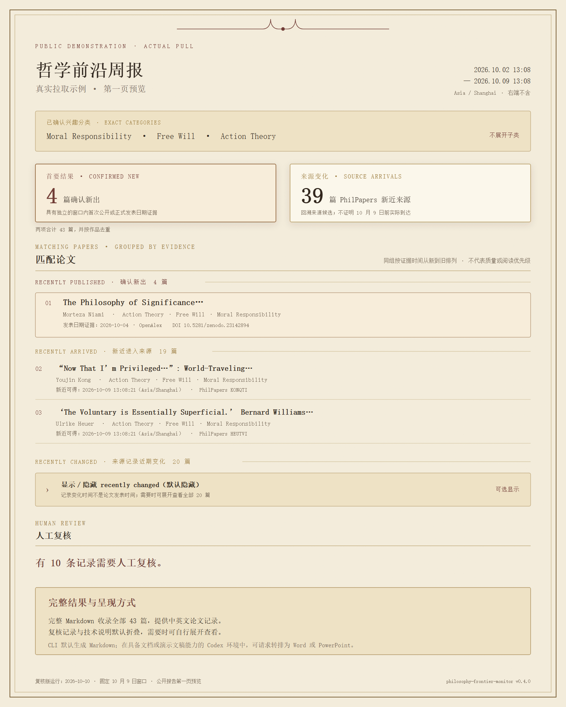

# Philosophy Frontier Monitor

[English](README.en.md) | 简体中文

**从研究方向出发，检索已有哲学论文，持续追踪新作。**

Philosophy Frontier Monitor 是一个带本地 Python 程序的 Codex Skill。用中文或英文描述研究方向，
它会提出经过核验的 PhilPapers 分类，供你逐项确认；随后，你可以检索这些分类中的已有论文、
即时查看近期新作，或按当地时间定期生成周报。

每篇结果保留题名、作者、日期证据、命中分类和来源链接，让文献发现与后续阅读衔接起来。

[功能](#功能) · [安装与首次使用](#安装与首次使用) · [用法示例](#用法示例) ·
[真实报告](#真实报告) · [文档](#文档与来源说明) · [技术更新](#技术更新)



## 功能

同一份经你确认的研究范围，可以用于三种任务：

| 你要做什么 | 对应功能 | 得到什么 |
|---|---|---|
| 围绕研究方向查找已有论文 | 历史检索 · `pfm search` | 按年份、作品类型或分类筛选的论文清单；有引用量时据此排序，并标明缺失数据 |
| 现在查看最近几天的相关新作 | 即时拉取 · `pfm pull-now` | 最近 1—31 个当地日内的报告，区分发表、新近可得和来源记录变化 |
| 持续跟进研究领域 | 每周监测 · `pfm weekly-run` / `pfm catch-up` | 建立历史基线后按周生成报告，合并重复来源，并顺序补跑错过的窗口 |

- **从自然语言确定范围**：先把研究兴趣映射为真实 PhilPapers 分类，再由你接受、拒绝或暂缓每个候选。
- **逐篇保留核验依据**：合并同一作品的多个来源，展示日期与类型证据；有冲突的记录进入逐篇复核。
- **提供中英文报告**：列出匹配作品、来源覆盖和待复核记录，便于继续查证与阅读。
- **可选扩展中文来源**：启用后，单列有界的知网空间、万方题录和已复核刊方期次线索。

历史检索覆盖本次分类 feed 实际返回的记录；每周监测与即时拉取另按相应时间窗口判断新近性。
引用量仅用于检索排序，论文收录由已确认的分类与证据规则决定。具体范围见
[检索用法](references/paper-search.md)和[监测政策](references/monitoring-policy.md)。

## 安装与首次使用

需要 **Codex、Git、[uv](https://docs.astral.sh/uv/) 和 Python 3.12 或 3.13**，以及可访问所选
学术来源的网络。Windows 已完成真实定时运行验证；macOS／Linux 已适配路径，定时运行仍待实机验证。

### 1. 安装 Skill

在 Codex 中发送：

```text
$skill-installer 请从 https://github.com/AsahinaMafuyu0127/philosophy-frontier-monitor
仓库根目录安装这个 Skill；path 使用 .，安装名称使用 philosophy-frontier-monitor。
```

### 2. 描述研究方向，完成首次配置

安装完成后，在下一轮对话中发送；若尚未发现 Skill，重启 Codex 后再调用：

```text
请使用 $philosophy-frontier-monitor。我关注道德责任、自由意志与行动理论，
请先提出经过核验的 PhilPapers 分类，由我逐项确认，再完成本地环境和私人配置。
我希望每周一当地时间早上八点收到报告，请引导我建立历史基线并完成第一次周报。
凭据只保存在本机，不要让我把 API key、密码或 Cookie 粘贴到聊天中。
```

将示例中的研究方向和时间换成自己的需要即可。你不需要预先知道分类名称。
Skill 会引导你建立 Python 环境、确认分类、将 taxonomy 所需凭据保存在本机，并先完成
历史基线、dry run 和正式周运行，再确认每周计划任务。默认时间为用户当地星期一 08:00。
公开个人主页可作为可选的兴趣补充；仅提供文字研究方向也可以完成配置。

<details>
<summary>终端安装后的环境检查</summary>

在安装器返回的 Skill 目录中运行。仅在尚无私人配置时，从公开示例创建 watchlist；
已有配置时直接复用，保留其中的研究范围与本地设置。

```powershell
uv sync --python 3.12
if (-not (Test-Path .\config\watchlist.yaml)) {
    Copy-Item .\config\watchlist.example.yaml .\config\watchlist.yaml
}
.\.venv\Scripts\pfm.exe doctor
```

macOS／Linux 对应的程序路径是 `.venv/bin/pfm`。完整步骤见
[安装与首次部署](references/installation.md)和
[英文安装说明](references/installation.en.md)。

</details>

## 用法示例

完成分类确认和本地配置后，可以直接向 Codex 提出以下请求。

### 查找已有论文

```text
请使用 $philosophy-frontier-monitor，检索我已确认分类中 2020—2026 年的论文，
有引用量数据时按引用量排序，列出题名、作者、年份、命中分类和来源链接。
引用量缺失的论文保留，并说明这次实际读取的来源范围。
```

历史检索直接复用已确认分类，无需先建立周报基线。有年份范围时按发表年份筛选；
不限制年份时可保留缺少日期的已核验论文。完整规则与命令见[检索用法](references/paper-search.md)。

### 即时查看最近一周

```text
请使用 $philosophy-frontier-monitor，即时拉取我已确认研究范围最近 7 个当地日的相关论文，
区分确认新出、新近可得和来源记录变化，并列出需要人工复核的记录。
```

即时拉取单独生成报告，保留每周通知进度。窗口可以改为 1—31 个当地日。

### 调整每周报告时间

```text
请使用 $philosophy-frontier-monitor，把每周报告改为当地时间星期五下午六点，
保留我已确认的研究范围，并在创建或更新计划任务前让我确认最终时间。
```

调度使用用户当地时区。研究范围、报告时间和是否启用中文来源都可以单独调整。

## 真实报告

### 公开示例：用三个真实标签实际拉取

**2026-10-10 逐篇复核版。**示例沿用北京时间 10 月 2 日 13:08 至 10 月 9 日 13:08
的七日窗口（右端不含），并于 10 月 10 日重新读取来源、复核作品类型。监测范围是 PhilPapers
的 `Moral Responsibility`（4590）、`Free Will`（347）和 `Action Theory`（5992）三个精确分类。
三条官方 RSS 均成功读取。

这次复跑得到 **4 篇确认新出的作品**和 **39 篇来源变化候选**，合计 43 篇去重后的匹配作品；
另有 **10 条记录需要人工复核**。完整报告按 **recently published**（4 篇）、
**recently arrived**（19 篇）和 **recently changed**（20 篇）分组。四篇确认新出有窗口内发表日期证据；
其余 39 篇按复跑时的来源记录回溯分类，到达时间的判断见报告中的来源说明。

#### 四篇确认新出

日期来自本次 OpenAlex 书目核验；三篇曾有作品类型冲突的记录还核对了原件。

1. **[The Philosophy of Significance How Importance Is Constituted, Experienced, and Transformed](https://doi.org/10.5281/zenodo.23142894)** — Morteza Niami；论文（article）；发表日期证据：2026-10-04；命中 Action Theory、Free Will、Moral Responsibility。[核查原文 PDF](https://zenodo.org/records/23142895/files/The_Philosophy_of_Significance.pdf?download=1)。
2. **[Before Fatelessness: From Fatality and Abolition to Operational Reconfiguration](https://doi.org/10.5281/zenodo.23123292)** — Fujie Naoto；手稿（manuscript）；发表日期证据：2026-10-03；命中 Action Theory、Free Will。[核查原文 DOCX](https://zenodo.org/records/23123293/files/fateless_fixed.docx?download=1)。
3. **[Free Will and the Significance of Basic Undeservedness](https://doi.org/10.1007/s11406-026-01037-6)** — Gunnar Björnsson；论文（article）；发表日期证据：2026-10-03；命中 Free Will、Moral Responsibility。
4. **[When the Past Cannot Be Narrated Experience, Trace, Memory, and the Emergence of Narrative](https://doi.org/10.5281/zenodo.23126385)** — Morteza Niami；论文（article）；发表日期证据：2026-10-03；命中 Action Theory、Free Will。[核查原文 PDF](https://zenodo.org/api/records/23126386/files/When%20the%20Past%20Cannot%20Be%20Narrated.pdf/content)。

下图展示四篇题录及报告分组。[完整周报](examples/public-demo-weekly-report.md)收录 43 篇作品的
中英文记录、复核队列和来源说明；[10 月 9 日原始快照](examples/public-demo-weekly-report-2026-10-09-original.md)
与[9 月 9 日快照](examples/public-demo-weekly-report-2026-09-09.md)可供比较。



<details>
<summary>查看本次拉取的覆盖与核验限制</summary>

三个分类的官方 RSS 各返回 500 条；程序读完了这些返回内容，但恰好 500 条不能证明来源没有
条数上限，也不能证明当前 RSS 覆盖了七日内全部作品。PhilArchive OAI 在本窗口内返回 148,183 条
来源事件，主要为记录变化，不能当作新发表论文。本次复跑复用了 OAI 缓存，未重新从 OAI 网络收割。
OpenAlex 书目核验遇到限额与请求失败，21 条候选等待后续自动重试；还有 10 条需人工复核，
均未计入 43 篇匹配结果。剩余类型冲突的原始稿件尚不可读，不会仅凭摘要强行裁定。
本示例未启用知网、万方，也未实时巡查中文期刊原站。完整的来源状态和证据边界见报告末尾。

</details>

CLI 生成 Markdown 报告；在具备文档或演示文稿生成能力的 Codex 环境中，还可以把报告转排为
**Word（.docx）** 或 **PowerPoint（.pptx）**。转排前如需展开来源记录变化组，可加
`--show-recently-changed`。

## 文档与来源说明

| 你想了解的内容 | 文档 |
|---|---|
| 安装、凭据、本地运行目录、首次基线与缓存管理 | [安装与首次部署](references/installation.md) |
| 历史检索、年份与类型筛选、引用量及缺失值 | [兴趣论文检索](references/paper-search.md) |
| 新论文判定、监测窗口与报告收录 | [监测政策](references/monitoring-policy.md) · [时间与版本语义](references/date-and-version-semantics.md) |
| 来源分工与中文期刊覆盖 | [来源目录](references/source-catalog.md) · [中文来源扩展](references/chinese-source-expansion.md) |
| 逐篇核查与裁定回填 | [作品类型复核](references/work-type-policy.md) · [书目同一性复核](references/identity-review-policy.md) |
| 英文命令指南 | [English user guide](references/usage.en.md) |

PhilPapers 分类 feed 提供分类成员关系，PhilArchive OAI 提供来源记录变化，Crossref／OpenAlex
辅助核对书目、作品类型和日期。OAI 的记录时间与作品发表日期分别呈现。
启用中文来源后，刊方目录、知网与万方线索按来源和日期精度单列；当前可自动扫描九种期刊的
刊方目录，其他登记期刊仍需人工核查。报告说明本次实际读取范围及仍需复核的记录。

## 当前版本

最近发布的应用版本是 [`v0.4.0`](https://github.com/AsahinaMafuyu0127/philosophy-frontier-monitor/releases/tag/v0.4.0)。
当前代码还包含尚未纳入该版本标签的逐篇作品类型、书目与同一性复核改进，内部证据管线版本为 `0.6.2`。

| 能力 | 当前状态 |
|---|---|
| 兴趣映射、分类确认、历史基线与每周监测 | 稳定 |
| 即时拉取、历史论文检索与中英文报告 | 稳定 |
| OAI 跨运行缓存、分页恢复与增量刷新 | 稳定 |
| 有界中文题录与已复核期次线索 | `v0.4.0` 起可选启用 |

中文线索按其来源和月份证据单独展示。当前可单独扫描九种期刊的刊方目录，其他登记期刊仍需
人工核查；具体来源和录入规则见[中文来源说明](references/chinese-source-expansion.md)。

OAI 增量候选思路受 [`sea9401/philosophy-mcp`](https://github.com/sea9401/philosophy-mcp)
的 `list_recent` 启发。本项目在此基础上实现完整分页、窗口过滤、分类交集、日期区分和
跨运行恢复。上游版本、许可证与实现比较见[设计来源](references/design-lineage.md)。
版本沿革见 [CHANGELOG.md](CHANGELOG.md)，贡献要求见 [CONTRIBUTING.md](CONTRIBUTING.md)。

## 安全与来源边界

私人研究方向、已确认分类、凭据、SQLite 状态、缓存和报告默认保存在本机；`config/watchlist.yaml`、
`var/`、`reports/` 与 `.env` 受 Git 忽略规则保护。API key 从私人文件或进程环境读取。
OAI 缓存保存恢复所需的最小记录证据和分页令牌；状态命令只显示计数与覆盖信息。

报告依据实际读取的分类和来源组织作品。来源覆盖、日期精度和仍需复核的记录随报告呈现。
项目默认读取书目与元数据，全文获取由研究者另行决定。详见[安全与隐私政策](references/security-and-privacy.md)、
[来源目录](references/source-catalog.md)、[时间与版本语义](references/date-and-version-semantics.md)
及[第三方声明](THIRD_PARTY_NOTICES.md)。

## 问题反馈

- 维护者：**Asahina Mafuyu**
- 联系邮箱：[junxuanxie@stu.xjtu.edu.cn](mailto:junxuanxie@stu.xjtu.edu.cn)

安装问题、可复现错误和改进建议可提交到 [GitHub Issues](https://github.com/AsahinaMafuyu0127/philosophy-frontier-monitor/issues)。
请附版本、系统、命令、窗口天数和去除私人信息后的错误摘要；即时拉取问题还可附
`pfm oai-cache status` 的计数与覆盖状态。凭据、私人配置、数据库和完整报告留在本机。
涉及凭据或私人数据泄露的漏洞，请按 [SECURITY.md](SECURITY.md) 使用 GitHub Private Vulnerability Reporting。

## 技术更新

### 2026-10-25：核对 OpenAlex 批量书目的完整分页

参照公开论文检索 Skill 对来源分页和覆盖缺口的处理，DOI 与题名批查现在核对 OpenAlex
声明的结果总数；只有存在后续记录时才继续请求，最多读取三页。超过边界、短页或重复记录会
明确作为来源不完整处理，避免把首屏书目误当作全部可比较作品。周报、即时拉取与历史检索
共用这一证据门槛，原有分类、日期、作品类型及人工复核规则继续适用。
具体依据与边界见[设计来源](references/design-lineage.md#7-2026-10-25-论文检索-skill-代码结构复核)
和[同一性复核政策](references/identity-review-policy.md)。

本次为代码分支更新；489 项测试、Ruff 和 Skill 校验通过，覆盖分页、异常响应及三种功能
适用路径；提交后的干净检出也通过只读发布检查。
没有重新采集私人论文来源，也未创建版本标签或 GitHub Release。

### 2026-10-25：按使用场景重整中英文介绍页

介绍页将三种功能、安装步骤、可复制的提问示例和真实周报集中呈现，增加文档导航，
将历次技术更新移至页尾并保留历史正文。中英文同步保留公开示例的四篇确认新出、
43 篇匹配作品、10 条人工复核及覆盖说明。终端配置示例会先检查私人 watchlist 是否存在。

本次为分支文档更新。验证涵盖本地链接、页内导航、Markdown 折叠结构、双语内容与原示例及
历史更新的保留检查；没有重新拉取论文来源，也未创建版本标签或 GitHub Release。

<details>
<summary>技术更新：保存书目同一性比较对象并支持逐对复核（2026-10-18）</summary>

## 技术更新：保存书目同一性比较对象并支持逐对复核（2026-10-18）

周报、即时拉取与历史检索发现译名、改题等书目同一性疑问时，私人队列现在保存
引发疑问的 Crossref／OpenAlex 具体记录：题名、作者、标识符、日期和比较理由。
逐篇核对后，可用 `--identity-reviews` 提交与两条记录及当前证据绑定的
`equivalent`／`distinct` 裁定；来源书目变化时旧裁定失效。身份裁定只处理
这一对作品关系，原有的发表日期、七日窗口、作品类型、分类与周报状态规则
继续独立执行。三种模式的离线回归已覆盖队列、复跑及旧作拦截。
这是代码分支更新，没有创建新的版本标签或 GitHub Release。
格式与命令见[作品同一性逐对复核](references/identity-review-policy.md)。

</details>

<details>
<summary>技术更新：刊方年份补证可恢复缺少年份提示的论文（2026-10-18）</summary>

## 技术更新：刊方年份补证可恢复缺少年份提示的论文（2026-10-18）

历史检索指定年份时，逐篇核实的刊方书目若给出发表年份，即使 PhilPapers feed
缺少年份提示，也可继续接受类型、身份和年份核验。无 DOI 的会议论文可保存
出版机构核实的同篇书目年份，并将 DOI 和引用量如实留空。仅有作品类型裁定
仍不能补足年份；窗外年份继续排除。这个变更只涉及历史检索的年份入口；
周报与即时拉取继续按各自的七日窗口及新近性证据判断。私人复核队列现列出
缺少年份提示的记录，供逐篇补查。离线回归覆盖年份入口、私人队列、无 DOI
会议论文、窗外年份及仅有类型裁定的情况。这是代码分支更新，
没有创建新的版本标签或 GitHub Release。操作见[历史检索规则](references/paper-search.md)。

</details>

<details>
<summary>技术更新：逐篇复核可更正来源误标与书目截断（2026-10-17）</summary>

## 技术更新：逐篇复核可更正来源误标与书目截断（2026-10-17）

周报、即时拉取和历史检索共用的作品类型复核现在可处理缺少类型标签的记录，
也可在原刊证据明确时更正原先标为 article 的非论文。检索的私人队列同时列出
未确认类型和本页已纳入论文的来源标签与证据指纹；旧指纹不会覆盖变化的来源。
历史检索另可读取私人出版方书目复核，按确切记录、题名、首作者和 DOI 补证
完整题名、实际作者及发表年份，供书目题名被索引截短时使用。类型裁定和书目
补证分别保存；有年份范围时仍要求正式发表年份。书目接口失败会在报告中明确
标示结果不完整。离线回归覆盖误标社论、无标签论文、截短题名、作者更正、
旧指纹和来源失败。472 项测试、Ruff 与 Skill 校验通过；未据此重新生成
私人正式周报或宣布新版本。
操作见[历史检索规则](references/paper-search.md)与
[结构化作品类型政策](references/work-type-policy.md)。

</details>

<details>
<summary>技术更新：三种模式的批量书目处理提速（2026-10-17）</summary>

## 技术更新：三种模式的批量书目处理提速（2026-10-17）

历史检索、即时拉取和周报现在共用 OpenAlex 书目候选索引。索引只缩小需要比较的范围；
共同 DOI、题名正字法和可能相容的首位作者仍交给原有书目比较器判定。出现第二条等价
书目就保留“身份未确认”，不选择引用量较高的版本。历史检索的确切标识符合并，知网
候选与刊方期次的日期补证、知网与 PhilPapers 的同题提示，以及周报新期次的首次复核
时间计算也改为按键定位。周报和即时拉取的标题批量缓存、失败作品反查来源记录只遍历
相关记录。分类、日期、作品类型、人工复核和私人状态规则保持原有门槛。

在 600 条候选与 600 条题名相近、作者各异的合成书目上，周报／即时拉取共用的局部
身份匹配由约 4.37 秒降至 0.006 秒；1,000 个查询题名与 1,000 条返回书目的缓存匹配
由约 1.49 秒降至 0.002 秒。历史检索在同样 600×600 规模的离线完整运行约需
0.05–0.06 秒；同作者且高度相近的 600 条歧义书目仍全部待核。这些测量没有远程
请求，不能代表真实周报总耗时。完整测试、Ruff、Skill 校验、只读发布检查及新旧
比较结果对照均已执行；这是代码分支更新，不创建新的版本标签或 GitHub Release。
详细的书目身份和日期门槛见[历史检索规则](references/paper-search.md)与
[监测政策](references/monitoring-policy.md)。

本次工作区同步还纳入此前仅保留在本地的两项实现。知网候选的刊方日期补证集中到
`cnki_dates.py`，由周报、即时拉取、历史检索和只读候选准备脚本共用；显式期次月份、
逐篇日期、冲突及证据链接继续按同一规则处理。`journal-watch import-toc` 支持在浏览器
人工核实**已知官方公众号原帖**后，导入有上限的完整作者题名目录；它要求同一原帖 URL
已有复核过的期次，并校验日期、条数与重复题名。《现代哲学》2026 年第 5 期原帖明示
9 月号、10 月 9 日公告，18 条目录曾导入 Git 忽略的本地观察库；作品类型、兴趣判断及
知网／万方逐篇可见性仍未由此确认。新路径不把公告日当作逐篇发表日，也不绕过微信验证页。
合并后 456 项测试和 Ruff 检查通过；没有重新执行线上采集或改写私人监测状态。
相关边界见[中文来源政策](references/chinese-source-expansion.md)和
[刊方观察规则](references/publisher-article-observation.md)。此次同步不创建新版本标签或
GitHub Release。

</details>

<details>
<summary>查看往期技术更新（20 条）</summary>

<details>
<summary>技术更新：三种模式共用作品类型逐篇复核（2026-10-12）</summary>

## 技术更新：三种模式共用作品类型逐篇复核（2026-10-12）

周报、即时拉取和历史检索现在共用结构化作品类型的裁定及私人逐篇复核规则。检索会先合并
同一作品从多个来源得到的类型证据，再处理论文与书籍等冲突；未确认条目可输出带来源类型
和证据指纹的私人队列。核查本篇稿件或出版方记录后，检索可用 `--type-reviews` 回填裁定，
证据变化时旧裁定不会自动适用。历史检索仍按原有分类和年份条件筛选，作品类型裁定不会
代替发表日期或书目身份核验。450 项测试、Ruff、Skill 校验和只读发布检查通过；未作线上来源重拉，
未创建新版本标签或 GitHub Release。后续同类证据判断改动会同步检查三种功能，完成适用验证
并通过 PR 检查后直接合入 `main`；各功能原有时间范围与状态规则继续适用。操作边界见
[结构化作品类型政策](references/work-type-policy.md)和[贡献说明](CONTRIBUTING.md)。

</details>

<details>
<summary>技术更新：介绍页文字与更新记录整理（2026-10-12）</summary>

## 技术更新：介绍页文字与更新记录整理（2026-10-12）

中英文介绍页重新组织了项目用途、公开示例、功能、版本与使用说明，保留读者理解报告所需的
来源范围和日期证据。最新更新直接显示；17 条往期技术更新可在下方按需展开。
已核对双语页面的示例数字、四篇题录、版本、本地链接及折叠结构；17 条历史正文保持完整，
只读发布检查通过。
本次是文档展示更新，尚未创建新的版本标签或 GitHub Release。

</details>

<details>
<summary>技术更新：公开示例完整展示四篇确认新出（2026-10-10）</summary>

## 技术更新：公开示例完整展示四篇确认新出（2026-10-10）

介绍页现在直接列出四篇确认新出的完整题名、作者、作品类型、日期证据、命中分类和稳定链接，
三篇逐篇裁定的作品还附有核查原文链接；中英文介绍页和 SVG／PNG 预览同步更新。预览图不再
省略第一篇的题名或只展示一篇确认新出。43 篇匹配作品、10 条人工复核及回溯来源的证据边界
均沿用已核对的公开报告，没有重新拉取或修改论文记录。已检查四篇与中英文报告逐项对应，
并重新渲染、查看预览图；本次是分支展示更新，未创建版本标签或 GitHub Release。

</details>

<details>
<summary>技术更新：作品类型冲突的逐篇复核（2026-10-10）</summary>

## 技术更新：作品类型冲突的逐篇复核（2026-10-10）

内部证据管线升至 `0.6.2`。OpenAlex／Crossref 的兜底 `other` 不再单独否决另一来源的明确论文类型；
书籍、数据集、会议摘要等明确冲突则生成完整的私人逐篇复核队列。队列保留各来源原始类型、日期和证据指纹；
skill 现在要求 Codex 优先打开七日窗口内的冲突作品，查阅稿件或出版方页面，自主判断作品形式，再以
带有来源链接和依据的私人裁定文件回填。回填必须匹配 PhilPapers 记录、题名和当次证据指纹；
来源改变即重新复核。即时拉取可以固定首次运行的窗口终点复跑，周报先试运行再提交，避免把预备报告
当作最终结论。论文形式的裁定仍须通过独立的新近性和日期门槛。

中英文报告完整列出待复核作品及逐来源类型，PhilArchive OAI 类型 URI 的安全展示也已修正。
对公开示例固定原七日窗口逐篇复核后重新拉取，确认新出从 1 篇增为 4 篇，类型冲突从 15 条降为
1 条；最终报告有 43 篇匹配作品、10 条需人工复核。10 月 9 日原始快照单独保留，复核版明确标记
为 10 月 10 日重新读取来源，不能视为历史 feed 的精确重建；其中 39 条来源变化只是回溯投影。
已读原件与裁定留在 Git 忽略的私人目录，本次没有重写既有正式周报状态或私人配置。
今后的逐篇复核首次拉取会在私人队列中保存分类 feed
清单，第二次以 `--review-queue-input` 原样复用，避免重拉 RSS 后把来源到达时间倒填。
447 项测试、Ruff、Skill 校验、公开示例一致性检查与只读发布检查通过。
具体规则与私人裁定格式见[结构化作品类型政策](references/work-type-policy.md)。这属于未发布的代码和说明更新，
未创建新版本标签或 GitHub Release。

</details>

<details>
<summary>技术更新：官方 RSS 直读与公开周报刷新（2026-10-09）</summary>

<a id="technical-update-2026-10-09-official-rss-link"></a>

## 技术更新：官方 RSS 直读与公开周报刷新（2026-10-09）

本机分类页的命令行 HTTP 403 确认为 Cloudflare 安全验证。经用户在正常浏览器完成页面验证后，
三个分类均由各自页面控件生成官方 RSS 链接；私人 watchlist 的可选 `official_rss_url` 经过域名、
分类身份与未筛选参数核对，可直接读取这些链接，原有证据规则不变。隔离七日 `pull-now` 实际完成，
报告列出 1 篇确认新出、34 篇新近来源，45 条需人工复核。来源覆盖、未完成核验与上游限制
保留在报告的可选展开说明中；正式周报状态未推进。433 项测试、Ruff、Skill 校验和只读发布检查通过。
来源与方法见[完整公开报告](examples/public-demo-weekly-report.md)及[来源目录](references/source-catalog.md#2026-10-09-访问复核)。
本次为分支文档与示例更新，未创建新版本标签或 GitHub Release。

</details>

<details>
<summary>技术更新：公开示例刷新状态（2026-10-08）</summary>

<a id="technical-update-2026-10-08-public-demo-refresh"></a>

## 技术更新：公开示例刷新状态（2026-10-08）

按原有三个公开分类与七日窗口在隔离配置中重试 `pull-now`，PhilPapers 分类页返回 HTTP 403；另以 `pfm feed` 独立核查，结果相同。两次请求都没有生成新报告，正式周报状态未推进。介绍页现明确标注 2026-09-09 成功快照的日期和本次更新未完成的事实，避免读者将旧统计误读为当前窗口。保留原报告及预览图，不改论文记录。此项为分支上的说明更新，未创建新版本标签或 GitHub Release。

</details>

<details>
<summary>技术更新：v0.4.0 正式发布（2026-10-08）</summary>

<a id="technical-update-2026-10-08-v040-release"></a>

## 技术更新：v0.4.0 正式发布（2026-10-08）

本次发布将已通过[中文期刊稳定化验收](references/chinese-journal-stabilization.md)的有界线索服务、
三模式刊方日期补证，以及周报来源状态与去重覆盖修正纳入 `v0.4.0`。应用版本元数据和
`uv.lock` 已同步；内部证据管线仍为 `0.6.0`。中文题录与期次继续作为单列候选，只有出版月份
有证据且与窗口相交的线索进入周报或即时拉取；逐篇“已确认新论文”、十五刊全自动覆盖、
全库召回率和固定到达时限均不在本次承诺内。安装包与最终验收记录见
[发布验收记录](references/v0.4-release-candidate.md)。发布检查现能正确排除 Git 链接工作树的
`.git` 指针文件；422 项测试、Ruff、Skill 校验、只读发布检查与锁定依赖安装已通过，源码包和
wheel 的必需文件及私人路径边界已核对，wheel 已在新环境安装并验证命令入口。本条对应
`v0.4.0` 标签与 GitHub Release。公开 `v0.3.0` 状态库的 schema 4 升至本版的 schema 6 前
会生成经完整性核验的备份；升级步骤见[安装指南](references/installation.md#升级至-v040-的核查)。

</details>

<details>
<summary>技术更新：周报来源状态与去重覆盖说明（2026-10-07）</summary>

<a id="technical-update-2026-10-07-weekly-coverage"></a>

## 技术更新：周报来源状态与去重覆盖说明（2026-10-07）

正式周报把本地已复核刊方期次的 `local_only` 与来源失败分开：当已检查的网络来源成功、
但本地官方期次本周没有新增时，不再误写“至少一个来源未成功检查”。知网与万方的
中文期刊覆盖说明增加“先前已列”的去重数量，使候选总数、缺月、窗外和本周正文条目
可以核对；已列期次仍不会重复呈现。对已成功生成报告的文字更正使用私人备份，
不重跑窗口或推进检查点。420 项测试、Ruff、Skill 校验与只读发布检查通过；
本项为本地代码与文档更新，未推送或创建版本标签、GitHub Release。

</details>

<details>
<summary>技术更新：中文期刊三模式日期补证与周报顺序（2026-09-28）</summary>

<a id="technical-update-2026-09-28-weekly-months"></a>

## 技术更新：中文期刊三模式日期补证与周报顺序（2026-09-28）

正式周报的完整中文与英文部分均先列中文刊方、知网及万方线索，再列 PhilPapers 论文。
知网期次的首次扫描基线也必须通过月份门槛：只有出版月份有证据且与周窗口相交的期次才列
相关题名；较早期次、缺月和日期冲突分别计入覆盖，不用期号、检索日或公告日推算月份。
刊方仅有公告日的期次不能据此进入正式周报；明示期次月份与提前刊出日仍分别保留。

知网缺日期时，可先用 `scripts/prepare_weekly_cnki.py --config config/watchlist.yaml` 只读
获取有限候选，再到同篇、同期的期刊主站核实。脚本默认准备周报，也支持
`--mode pull-now --days N` 与 `--mode search --year-from YYYY --year-to YYYY`；
三个模式共享补证逻辑，期次与逐篇字段保持一致。检索的 JSON 与 Markdown 展示核实日期、
原站链接及缺月／冲突状态，历史候选继续服从指定年份范围。私人逐篇核对文件新增可选
`issue_label_month` 和 `publication_date`，只有书目字段完整相符的刊方页面可以补证；
目录记录不能补出版日期。月份筛选先于逐篇万方查询。以往缺月的观察后来取得证据仍可列入
合格窗口；补跑旧窗口不会提前消耗未来刊期，已列期次继续去重。详见
[中文来源政策](references/chinese-source-expansion.md#43-月份精度与新期次观察)。

419 项测试与 Ruff 检查通过，覆盖基线筛选、窗外与缺月排除、书目冲突、日期格式、提前发行、
后续补证、未来窗口保留、中英文顺序，以及同一刊方证据在检索和即时模式间的复用、年份范围
和正式状态只读。程序读取已人工核实的日期，候选准备脚本不自动判断
官网日期，也不证明中文候选在本周首次发表或已完成兴趣匹配。本项为本地代码与文档更新，
未推送，未创建版本标签或 GitHub Release。

</details>

<details>
<summary>技术更新：第九个刊方目录与同篇到达证据收紧（2026-09-28）</summary>

<a id="technical-update-2026-09-28-journal-p2"></a>

## 技术更新：第九个刊方目录与同篇到达证据收紧（2026-09-28）

稳定性判定：经过[中文期刊稳定化验收](references/chinese-journal-stabilization.md)，**有界中文线索服务**在本次 `main` 分支更新中列为显式启用的稳定功能。`search` 提供带来源的中文题录候选，`pull-now` 只显示有明确月份且与近月窗口相交的线索，`weekly-run` 对已复核新期建基线、去重并披露来源故障。刊方自动目录仍须人工核实后才能进入这三种模式；中文候选不自动成为“已确认新发表论文”。公开示例默认关闭中文来源。此判定不承诺完整覆盖、固定数据库到达时限或研究兴趣论文召回率；本次代码推送不创建新版本标签或 GitHub Release。

新增[《孔子研究》主办方栏目](https://www.chinakongzi.org/category/kongziyanjiu_qikan/)的有界文字目录采集：只读取栏目索引和最新一期的[官网目录页](https://www.chinakongzi.org/content/6147_589032.html)，核对期号、15 条作者题名及页面后段逐篇标题。目录页的 2026-08-13 是官网公告日，系统保存为待核线索；该页未明示期次月份，不能从“第 4 期”推算月份或把其中论文称为八月新发表。由此，十五种登记期刊中已有九种可独立巡检（八种文字目录、一种 PDF），另外六种仍按站点人工核查。

同篇到达汇总现在只使用已保存查询范围、且标为完整查询的 `miss` 作为“最后一次完整未命中”。旧观察库里没有范围的未命中，以及截断查询，不会再形成看似精确的到达区间；原始观察行保留不变。逐期 `audit` 新增 `complete_misses`，使完整未命中与原始状态计数分开。[逐篇观察说明](references/publisher-article-observation.md)写明了核算口径与剩余站点状态。

P2 的逐期审计进一步区分刊方完整目录记录、人工确认的研究论文、人工确认的兴趣相关论文三个分母。作品类型或兴趣仍有未核、存疑时，较窄分母保持未知；来源可见性只有在该期所有研究论文都经过有范围的完整查询时才有可比较分母。`journal-watch catalog` 现明确标示每刊目录为 `automatic` 或 `manual`。对未自动采集的六刊完成[逐站入口审查](references/publisher-article-observation.md#2026-09-28-六站入口复核与自动采集决定)：《中国社会科学》官网有按期栏目及第 8 期公众号目录提示，但本机直连与使用边界尚不能支持自动采集；《伦理学研究》直连返回 502，《宗教学研究》逐篇目录为图片，其余三刊当前登记入口缺少当期刊方完整目次。六刊继续保留人工核对，未采集不表示无新刊。[来源使用说明](THIRD_PARTY_NOTICES.md#中文期刊发布渠道及补充检索)列出访问、频率、保存字段与公开范围，万方仍默认关闭。

2026-09-28 新建 Git 忽略的隔离库完成九站各一期巡检，共 132 条目录记录，九站均成功，默认没有逐篇数据库查询。首轮仅对《孔子研究》抽查 1 篇，知网公共检索面完整标题查询命中。随后在隔离副本显式开启一次万方 Query，对另一篇的双来源核对得到知网完整命中、万方完整未命中，两边各 1/1 页。该篇刊方作者姓名内的空格曾被误拆，现已修正并回归；合计只核对该刊两篇，其他 13 篇和其余刊物在本轮未核对。万方仍默认关闭，样本不支持全库召回率、全库漏收或固定收录时限结论。402 项测试、Ruff、Skill 校验和只读发布检查通过。本次作为 `main` 分支代码与文档更新，不创建新标签或 GitHub Release。

</details>

<details>
<summary>技术更新：中文期刊逐期分母与第八个刊方目录（2026-09-27）</summary>

<a id="technical-update-2026-09-27-journal-p2"></a>

## 技术更新：中文期刊逐期分母与第八个刊方目录（2026-09-27）

在已验收的 P0/P1 中文线索工作上，新增 `pfm journal-watch audit`：只有一次整期采集通过本站页数、条数核验，且本地题名仍与该次扫描一致，才显示刊方目录记录数这一参考分母；旧库和截断结果保持未知。逐篇审计同时记录知网公共检索面、可选万方 Query 的最后核对状态、检索范围及实际取得的页数。`classify` 允许人工依据登记的原站链接分别判断作品类型和与本地研究兴趣的关系；未核实记录不自动算成研究论文或兴趣论文。该审计库不改变检索、即时拉取和周报中的已匹配论文判定。

自动刊方入口由七种文字目录扩至八种：新增[中山大学《现代哲学》官网目录](https://mphilosophy.sysu.edu.cn/cat/124)的有界 PDF 解析。其[2026 年第 2 期公告页](https://mphilosophy.sysu.edu.cn/article/25746)标为 6 月 29 日发布，所附中文目录 PDF 明示“三月号”；系统把期次月份与网页公告日保存为两个独立待核证据链接，不将网页发布日期当作论文首发日。PDF 须通过登记 HTTPS 主机、大小、页数、内容类型、文件头及期次条数核对，仅在内存解析，不保存原文件；其余七个登记入口继续逐站人工复核。

2026-09-27 在 Git 忽略的隔离库中，八刊各一整期共取得 117 条刊方目录记录，默认巡检未查询数据库；另以每站一篇的额度对知网公共检索面作八次完整标题核对，八次均命中。其余 109 条未在该轮核对，万方未开启，117 条也未完成论文类型与兴趣的逐篇人工核实。这组结果不构成全库召回率或到达时间结论。398 项测试、Ruff、Skill 校验及只读发布检查通过。实现细节、人工复核命令及使用边界见[逐篇观察说明](references/publisher-article-observation.md)和[稳定化验收](references/chinese-journal-stabilization.md)。本次为本地分支更新，尚未推送、创建版本标签或发布 Release。

</details>

<details>
<summary>技术更新：刊方目录逐篇采集与到达区间观察（2026-09-27）</summary>

<a id="technical-update-2026-09-27-official-journals"></a>

## 技术更新：刊方目录逐篇采集与到达区间观察（2026-09-27）

已完成[中文期刊稳定化验收](references/chinese-journal-stabilization.md)中的 P0/P1 有界线索工作：独立检索现在会在本地刊方证据库读取失败时标明来源故障并继续；自动目录可通过 `pfm journal-watch pending` 查看，在核对原站后使用 `review --confirm-evidence` 提升为已复核期次。自动读到的公告日也先待核，原始所见时间与核实时间分开保存，重扫不会撤销核实；同一期多个官方链接在用户报告中只计一条，周报按首次核实周报告。隔离配置的三模式测试覆盖启用、关闭、近月窗口、周报基线及去重，来源错误测试覆盖限流、非 HTML、重定向、分页截断与单站失败。新建隔离库的真实试跑在《哲学研究》门户取得第 8 期 12 条目录记录（仍待核），在[《周易研究》官网目录](https://zhouyi.sdu.edu.cn/info/1033/2558.htm)取得第 4 期 11 条；核对官网明示的 2026-08-21 公告日后，仅在隔离库复核该期。这个日期不代表逐篇首次发表日。中文题录候选仍与已匹配论文分栏，逐篇确认及全部中文期刊覆盖尚未完成。本次为未推送的本地分支更新，未发布版本标签或 Release。

本次最终验证为 391 项测试、Ruff、skill 校验及只读发布检查通过。真实来源试跑只覆盖上述两站；没有对七站的长期可用性或全部中文哲学论文的召回做出保证。

已更正[中文来源政策](references/chinese-source-expansion.md)中早期“《哲学动态》门户仅到第 7 期、目录尚未自动采集”的过时记录：本次七站实采时门户为第 8 期，公众号第 9 期仍待读取原帖核实。此更正不把自动目录记录直接升级为已复核论文。

新增[中文期刊稳定化验收](references/chinese-journal-stabilization.md)：分别规定可先行验收的中文候选线索服务与尚未完成的“已确认新论文”服务，列出新安装三模式闭环、刊方证据复核、来源故障降级及覆盖抽样的通过条件。八周同篇观察只提供来源到达证据，不作为整套功能的唯一稳定门槛。本次仍为未推送的分支更新。

已对七种可取得完整文字目次的期刊建立有界逐站采集：《自然辩证法通讯》《周易研究》《哲学研究》《哲学动态》《哲学分析》《自然辩证法研究》《科学技术哲学研究》。`pfm journal-watch run` 顺序扫描全部七站，默认只巡检刊方目录；显式设置逐篇篇数后才核对知网公开检索面，万方授权 Query 还须显式使用 `--with-wanfang`。逐篇核对有每日总篇数及每站篇数双重上限，一站失败不会中断其余站点。每次结果存入 Git 忽略的本地库。目录巡检为新期提供线索；重复查询同篇的到达观察是可选的来源评估，其他用户直接使用检索、即时拉取或周报时无需先建立观察基线。完整未命中后首次同篇命中只能形成检索可见到达区间，首次即命中和持续未命中分别为左删失与右删失证据，均不能证明数据库全库漏收。

七站最新一期实采分别取得 14、11、12、12、16、17、18 条有作者的目录记录，合计 100 条。原有三站首轮各核对 5 条，新增四站首轮各核对 1 条；这 19 条在知网公开检索面均命中，先前显式开展的万方精确题名查询命中 2 条、未命中 17 条。它们是本次有界样本，不是总体漏检率。当前同篇复查先设约八周的阶段性评估节点，万方延迟研究仅在显式启用后另行确定范围。《哲学动态》编辑部门户仍显示第 8 期；用户提供的第 9 期公众号链接因正文未能读取，继续保留为待核线索，不能因门户尚未更新而否定新期。其余八个已登记入口保留逐站人工复核状态。379 项测试与 Ruff、只读发布检查通过；尚无跨日到达区间统计。用法、证据与各站限制见[刊方目录逐篇观察](references/publisher-article-observation.md)。本次未推送、未创建版本标签或 Release。

</details>

<details>
<summary>技术更新：重点期刊官方渠道优先的期次监控库（2026-09-27）</summary>

## 技术更新：重点期刊官方渠道优先的期次监控库（2026-09-27）

中文期刊的期次与日期现在优先核对编辑部或主办单位的官网、正式期刊门户和已核实的
官方公众号；知网空间、万方用于补充发现与书目交叉核对。新增
[15 种期刊的官方入口目录](config/official-journals.yaml)与 Git 忽略的本地期次
证据库。`pfm journal-watch catalog` 可查看目录；`pfm journal-watch list` 可查看本地
观察。人工录入须附官方证据 URL，并把期次标示月份、刊出日、公告日和首次观察时间
分开保存。只有 `reviewed` 记录才进入检索、即时拉取与周报的期次线索；已复核的
官方月份还可补足同刊同年同期且缺月的知网题录，不会覆盖相互冲突的原始月份。
周报只在期次首次核实发生的那一周提及，避免同一个月重复报告同一期。

《哲学动态》门户标明月刊，但本次无法读取用户提供的第 9 期
[公众号原帖](https://mp.weixin.qq.com/s/eeYI8s6Y_f9J3zbJ73XgSg)正文，故该链接只作为
`pending` 线索，暂不推断发布日期或九月标示月份。另查到《哲学研究》杂志社公布的
2026 年出版计划：该刊拟每月 25 日出版，
《世界哲学》拟单月 2 日出版；计划日期不作为某期实际刊出日。
当前库仍依赖人工核对各刊期次，尚未自动逐站采集目录或核实逐篇论文的兴趣匹配；
官方期次线索不会计入已核验新论文。
已在本机验证目录命令返回 15 刊、私人库录入与读取、368 项测试、Ruff 检查、
skill 校验和发布检查；没有对各期刊实施连续自动巡查。
本次为本地分支更新，未推送、未创建版本标签或 GitHub Release。
详见[中文来源与录入门槛](references/chinese-source-expansion.md#24-官方期刊监控库与证据录入)。

</details>

<details>
<summary>技术更新：重点期刊原站目录的月份核对基线（2026-09-27）</summary>

<a id="technical-update-2026-09-27-audit"></a>

## 技术更新：重点期刊原站目录的月份核对基线（2026-09-27）

建立了本地、Git 忽略的重点期刊目录抽样审计：按原站的期次和月份证据，逐篇核对
知网空间与现有个人订阅万方 Query 的题录，并记录本次观察时间。八篇有界样本中，
知网空间均找到但均缺显式月份；万方三篇完全同题、一篇带副题名差异，另四篇
在本次有界查询中未核对到。两篇原站明确标为九月的文章，即使另被私人检索词
发现，仍无法凭现有知网题录通过近月月份门槛；本次未测私人词表对此样本的召回。
未命中不等于数据库全库未收录；一次快照也
不能推算真实收录延迟。另一区别是期刊原站“刊出日期”与万方“文摘上网日期”
不能混写为逐篇首次发表日。

[来源证据与试验决策](references/chinese-source-expansion.md#23-重点期刊原站目录的月份证据与抽样基线)
记录了可复核的原站链接、访问限制和月份语义。现阶段暂不扩大为跨期刊自动来源；
优先考虑对有明确月份的固定期次目录作窄范围试验，待连续复查后再决定扩展。
本次为分支内审计与文档更新，未创建版本标签或 GitHub Release，也未推送。

</details>

<details>
<summary>技术更新：个人订阅下的万方独立发现（2026-09-27）</summary>

<a id="technical-update-2026-09-23"></a>

## 技术更新：个人订阅下的万方独立发现（2026-09-27）

中文期刊补充来源新增可选的**万方独立题录发现**：使用用户现有 AI HUB Query 订阅，
按私人中文检索词、年份和最多两页的明确上限查 `OpenPeriodicalChi`，不再要求论文先被
知网空间搜到。独立检索单列候选；即时拉取仅列万方标示出版月份与滚动窗口相交的候选；
周报首次建立窗口内万方记录 ID 基线，以后只提示此前未列入窗口、且月份与该窗口相交的记录。
同一期后来出现新记录 ID 时也能形成观察线索。开关 `sources.wanfang.discover` 默认关闭，
可在私人 watchlist 中启用，默认每次至多两个词、每词每年一页；它会使用个人订阅的请求额度。
配置和来源边界见[中文论文来源扩展](references/chinese-source-expansion.md)。

2026-09-27 以通用词、有限请求实测了现有订阅的限定年份检索和出版时间排序。
万方题录同时出现“第 4 期”却写 1 月 1 日、以及晚于检索日的出版时间标示；因此程序
不把 `PublishDate` 当作逐篇首次发表日，1 月 1 日形式也不作为可靠月份证据。
中文候选继续与已核验 PhilPapers 论文分栏；知网空间与万方均是有界检索，截断和失败
单独披露，不能承诺全库覆盖。Crossref、DOAJ 和期刊原站可作后续补充，但各有收录或
访问范围，尚无免授权且可证明覆盖全部中文哲学期刊的单一替代源。新增独立发现、日期
占位、近月过滤及周报 ID 增量回归测试；本次分支更新没有创建新标签或 Release。

</details>

<details>
<summary>技术更新：知网空间候选与中文期刊期次观察（2026-09-23）</summary>

## 技术更新：知网空间候选与中文期刊期次观察（2026-09-23）

本次分支更新将**PhilPapers 全球候选与中文数据库补充候选**作为长期目标，不按作者机构过滤
既有 PhilPapers 结果。在私人 watchlist 中可选择开启 `sources.cnki_space`，用经用户认可的
中文检索词进行有页数上限的知网空间题录检索。项目借鉴第三方
[cnki-search MCP](https://github.com/Biogod2020/cnki-search) 的公开检索方法，以普通 HTTP 客户端
实现独立适配层，不运行第三方服务端或模拟浏览器。配置格式与证据口径见
[中文论文来源扩展说明](references/chinese-source-expansion.md)。

三个模式现在均可显示中文来源线索：`search` 单列未经逐篇核验的中文题录，不计入已确认论文
总数和引用量排序；`pull-now` 只读展示有明确月份证据、且月份与所选滚动窗口相交的期次；周报首次扫描建立期次基线，之后只
显示此前未见的期次，并将观察与周报状态一起提交。报告保留来源给出的年份、期号和首次观察
时间；“第 9 期”不自动解释为“9 月刊”，题录中的日级时间也不自动解释为论文首次发表日期。
网络受阻、结果结构异常或页数截断会显示为覆盖限制，不被解释为没有相关论文。

此次新增最小无凭据的 HTML 夹具，验证了题录解析、错误页、内容类型、分页中断与状态事务；
也以有限的公开检索试跑了已配置的私人术语。中文候选仍需逐篇核对期刊原站及发表时作者机构，
万方的少量候选随后已作书目核对，系统性的跨库核验与维普核对仍未完成；中文题录未合并进已核验论文主栏。知网空间不是完整 KNS，有限页
检索不能承诺覆盖中国或世界的全部论文。没有创建新版本标签或 GitHub Release。

随后接入 Git 忽略的私人逐篇证据文件：人工在期刊或目录页面核对题名、作者、刊名、年份与期次，
有逐篇机构证据时才标出中国机构署名；冲突或缺字段保持待核验。两条私人候选已分别据期刊逐篇
发布门户页面和另一目录页面核对书目字段，其中前者还支持中国机构署名；该发布门户由知网承载，
不等于万方或维普的独立复核。检索及周报会提示本次
已解析 PhilPapers 记录中的严格书目重合
线索，但不自动合并或改变已核验论文数量。国家哲学社会科学文献中心用户协议限制未经许可的
自动抓取；万方已展示试用订阅接口、维普的正式自动核验接口尚未获得授权。新增合成夹具验证相符、冲突、缺字段与
重合提示。具体格式和边界见[中文论文来源扩展说明](references/chinese-source-expansion.md)。

本次又接入可选的万方 AI HUB 题录交叉核对。用户已展示“万方文献检索”订阅页及 Query 接口说明；
配置启用后，程序只从本机环境变量 `WFDATA_APP_KEY` 或 Git 忽略的私人密钥文件读取 AppKey，
以有限条数和页数查询中文期刊题录，
比较知网候选的题名、作者、刊名、年份及期次，并在三种报告中标示相符、缺字段、冲突或未核对。
万方的 `OriginalOrganization` 是发文时机构线索，但程序尚不据此自动认定哪位作者属于中国机构；
无同题命中也不推断万方未收录。新增合成 JSON 夹具验证请求、字段结构、错误响应和分页截断；
本机已用试用订阅完成有限真实请求及知网候选的逐篇核对。实际响应把数字命中数编码为字符串，
将期刊题录放在 `Periodical` 对象中；解析器现兼容该结构，并在 `PublishYear` 为 0 时从
`PublishDate` 提取年份。私人检索结果与 AppKey 未进入公开文件。试用额度、长期稳定性和全库覆盖仍未核实。

本次还按用户要求收紧即时拉取的中文栏：不再把当年检出的期次全部列入最近一个月报告。
只有来源明确标示的卷期月份与所选滚动窗口相交，相关论文线索才显示；仅有年份或期号、
以及月份在窗口外的记录只计入覆盖统计，不显示题名。万方即时核对仅针对显示的线索。
月精度不能证明逐篇论文在窗口内首次发表；中文栏为空也不等于近月没有中文论文，用户可另行
要求扩大范围。历史 `search` 和正式周报的既有口径不变。已用合成跨月、缺月与窗外期次
验证过滤和报告呈现；没有创建新版本标签或 GitHub Release。

</details>

<details>
<summary>技术更新：公开示例的人工复核提示（2026-09-20）</summary>

<a id="technical-update-2026-09-20"></a>

## 技术更新：公开示例的人工复核提示（2026-09-20）

公开示例的覆盖说明现在只显示“有 18 条记录需要人工复核”，中英文介绍页与预览图同步调整。
完整示例的复核明细和技术说明默认折叠，读者可自行展开；原有论文记录及核验事实保留。
本次为文档与展示更新，已核对论文内容、折叠结构和链接，并重新渲染检查预览图。

</details>

<details>
<summary>技术更新：兴趣论文检索与当地时间调度（2026-09-19）</summary>

<a id="technical-update-2026-09-19"></a>

## 技术更新：兴趣论文检索与当地时间调度（2026-09-19）

本次 `main` 分支更新新增独立的 `pfm search`，按已确认的兴趣配置与 PhilPapers feed 标签查找
已有论文，支持任一／全部标签匹配、年份与论文类型筛选。检索不要求历史基线，也不推进周报
通知历史或改写长期订阅。此功能已随[代码提交 `9249da6`](https://github.com/AsahinaMafuyu0127/philosophy-frontier-monitor/commit/9249da600c79a63c2f55a973bcd98c60cd2361dd)
推送，尚未另建版本标签或 GitHub Release。

日期处理按用户的检索要求区分：**不限制年份时**，缺少 feed 日期、年份提示或正式发表日期的
论文仍可纳入，默认返回全部已确认匹配结果；只有用户明确限量时才分页。**指定年份范围时**，
没有 feed 年份提示、也没有适用的逐篇刊方年份裁定的记录在书目查询前排除；
最终年份筛选仍使用正式书目日期证据。

引用量采用 OpenAlex 的可用计数，已知值降序排列，缺失标注并置后，零次引用与缺失分开处理。
书籍、书章、书评等非论文形式不进入结果；类型或书目身份未确认的记录只提示存在、不报告
数量，并可提供已有来源供用户自愿核对，skill 不再为这些记录追加调查。冲突 DOI 不会因仅有
一个外部匹配就被视为身份已确认。

定时任务流程现在优先读取会话提供的用户时区，缺少时检测本机时区；“早上八点”等表达按当地
时间理解，在最终创建任务时统一确认星期、时间和时区，不在前期单独追问。既有订阅仍沿用其
已确认的时区。

功能提交通过 **319 项测试**、代码与格式检查、skill 校验及发布检查。Git 历史备份包也已纳入
私人文件保护。检索覆盖本次分类 feed 能够提供并确认的论文，不代表 PhilPapers 全站完整书目。
完整规则见[论文检索说明](references/paper-search.md)与[变更记录](CHANGELOG.md)。

今后的项目更新都会同步写入本页及英文页面的技术更新，并保留已有记录；这一要求已写入
[维护规则](CONTRIBUTING.md#网页技术更新与变更记录)。

</details>

<details>
<summary>技术更新：OAI 跨运行缓存与即时拉取收尾（2026-09-08）</summary>

## 技术更新：OAI 跨运行缓存与即时拉取收尾（2026-09-08）

证据管线 `0.6.0` 为 PhilArchive OAI 增量收割增加了可中断恢复的跨运行 SQLite 缓存。`pull-now`、
`weekly-run` 和 `catch-up` 默认复用已经完整收割的 OAI 窗口，只从网络补齐尚未覆盖的区间；可用
`--no-oai-cache` 临时关闭。缓存位于 Git 忽略的私人 `var/oai-cache.sqlite3`，与周报通知、基线和
检查点状态分离。

OAI 缓存只保留记录标识符、来源 `datestamp`、删除标记，以及程序实际使用的 `dc:identifier`、
`dc:date` 和 `dc:type`；不保存题名、作者、摘要或全文。缓存命中仍会重新执行当前窗口过滤、作品
类型处理和确认分类交集，不会因为此前见过某条记录而抑制本次即时报告或后续周报。

PhilArchive 当前提供秒级 OAI `datestamp`。收割器现在向前重叠一个秒级单位，并把 OAI 的包含式
`until` 精确转换为本地半开窗口 `[start, end)`，避免额外下载窗口结束日的无关记录。长冷启动会在
stderr 报告已完成分页数和累计记录数。每个成功页的最小记录和下一枚不透明 `resumptionToken`
在同一事务中落盘；中断后续跑从最近检查点继续。只有全部分页成功且暂存记录原子并入正式缓存后，
程序才把区间登记为已覆盖；过期或被上游拒绝的令牌会安全清空该缺口的暂存并从原窗口重新收割。

即时拉取的范围保持克制：成功 OAI 窗口未命中的完全无日期记录从本次滚动候选集移除；已经命中
OAI、但同时缺少 feed 时间、书目年份、DOI 和明确手稿／预印本类型的库存记录，进入私人、只含
来源 ID 散列的“日期证据不足集合”。普通拉取只提示集合数量，不逐条消耗书目查询，也不把它们
计入机器积压或人工复核；若后来出现任一上述证据，记录自动返回核验。这不是旧作或不相关判断，
也意味着完全缺少这些信号的新手稿可能不会出现在普通即时报告中。项目不为这部分记录增加付费墙
页面或逐篇 PhilPapers 抓取。`pull-now` 自 `v0.3.0` 起属于稳定
功能；它与每周监测共享证据标准，但仍是用户主动调用、只读且不推进通知历史的独立模式。完整规则见 [CHANGELOG.md](CHANGELOG.md)、
[监测政策](references/monitoring-policy.md)与[结构化作品类型政策](references/work-type-policy.md)。

</details>

</details>
